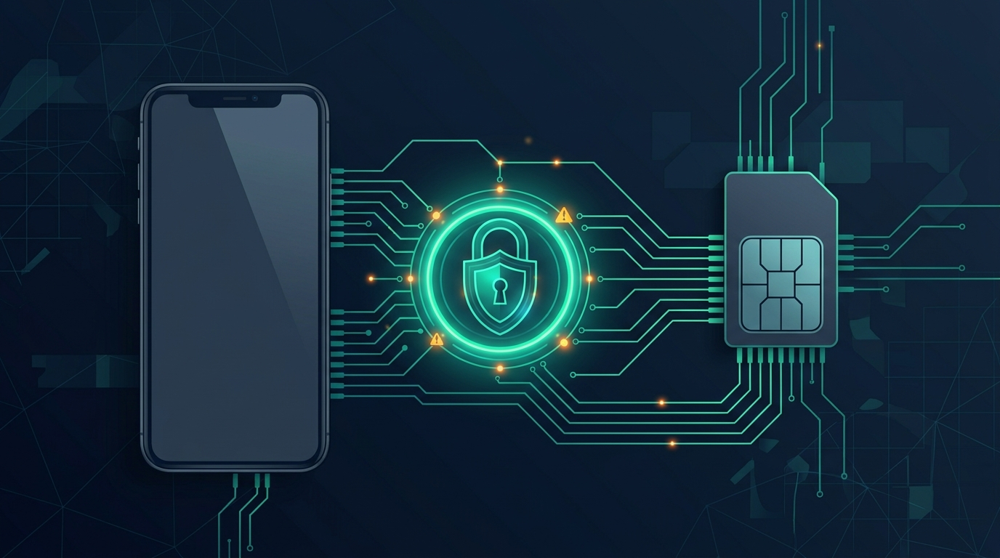

# WhatsApp SIM Binding Rules: Security & Fraud Prevention Guide

Telecommunications regulatory bodies and security frameworks are introducing stringent SIM-binding requirements for instant messaging platforms like WhatsApp. Designed to dismantle SIM swap fraud, OTP diversion syndicates, and financial identity theft, these rules bind application sessions directly to active device hardware identifiers and subscriber identity modules.\n\nOur latest telecommunications security briefing details how the new SIM binding protocols function, privacy safeguards, and what this means for dual-SIM users, businesses, and global roaming subscribers.\n\nRead the full regulatory and technical breakdown on our official security portal.

**[Read the full technical breakdown here](https://cyberupdates365.com/whatsapp-sim-binding-rules/)**

---
*Maintained by Kiran Sonawane | Senior Cloud & DevOps Engineer*
